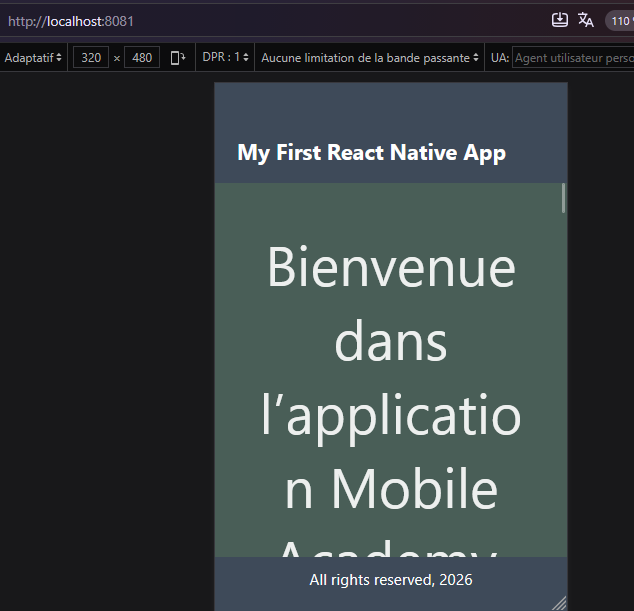

# welcome-scroll-rn

Lab 3 : construire un écran d'accueil défilant avec **ScrollView** en **React Native** (Expo).

Le texte de bienvenue est en grande taille et dépasse la hauteur de l'écran. Avec `ScrollView`, l'utilisateur peut faire défiler pour tout lire, et l'indicateur de défilement est blanc pour rester cohérent avec le thème sombre.


---

## Ce qu'il faut avoir

- [Node.js](https://nodejs.org) (version LTS)
- Un éditeur de code, par exemple [VS Code](https://code.visualstudio.com)
- L'app **Expo Go** sur le téléphone (ou un navigateur pour tester sur le web)

---

## Lancer le projet

**1. Télécharger le projet**

```
git clone https://github.com/Marouane-Chafiqi/welcome-scroll-rn.git
cd welcome-scroll-rn
```

**2. Installer les packages**

```
npm install
npx expo install --fix
```

**3. Démarrer l'app**

```
npx expo start
```

**4. Ouvrir l'app**

- **Téléphone** : scanner le QR code avec Expo Go
- **Navigateur** : appuyer sur la touche `w`

---

## Structure du projet

```
welcome-scroll-rn/
├── src/
│   ├── app/
│   │   ├── _layout.tsx         -> configuration de la navigation
│   │   └── index.tsx           -> assemblage header + écran + footer
│   ├── components/
│   │   ├── WelcomeScreen.tsx   -> l'écran d'accueil avec ScrollView
│   │   ├── AppHeader.tsx       -> l'en-tête
│   │   └── AppFooter.tsx       -> le pied de page
│   └── ScreenShots/
│       └── 1.png               -> capture d'écran
├── app.json
└── package.json
```

---

## Notions utilisées

- **ScrollView** : conteneur qui permet de faire défiler un contenu plus grand que l'écran
- **flex: 1** : le `ScrollView` occupe toute la hauteur disponible
- **indicatorStyle="white"** : barre de défilement blanche sur fond sombre (effet visible sur iOS)

---

## ScreenShots



